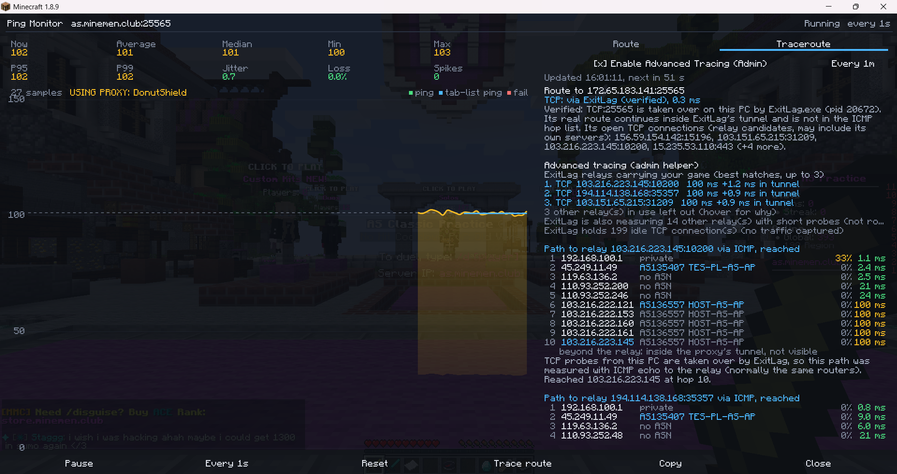

# SeekerNetDiagnostics

In-game ping monitor for **Minecraft 1.8.9 / Forge 11.15.1.2318**. It pings the server from inside the
game process, so the pings take the same route as your game connection (including ExitLag, if it
handles Minecraft), and shows everything on one screen.

**Why not `ping` or `tracert`?** ExitLag optimizes traffic per program. Command-line tools are separate
programs (and `ping` uses ICMP, which ExitLag doesn't route), so they show your normal route.

## Preview



## Safety

- Never touches game packets. Pings use their own separate connections.
- Never joins a server. Each ping is a server-list ping (status + ping/pong), like the Multiplayer menu.
- One connection at a time, at most one every 0.5 s, only to the server you choose.
- Pinging stops automatically when you leave the server.

## Install

Put `SeekerNetDiagnostics-1.8.9-2.0.0.jar` in your Forge 1.8.9 instance's `mods` folder (Prism: *Edit → Mods → Add file*).

## Build

You need **JDK 8**. The included Gradle 2.7 wrapper and ForgeGradle 2.1 don't work with newer Java.

```bash
./gradlew build
```

The jar is written to `build/libs/`. `build` also runs the tests (`./gradlew test`).

### IntelliJ

Modern IntelliJ can't import Gradle 2.7 projects, so generate a classic IntelliJ project instead:

```bash
./gradlew setupDecompWorkspace idea genIntellijRuns
```

1. Close the project in IntelliJ and delete the `.idea` folder.
2. Open `SeekerNetDiagnostics-1.8.9.ipr` (*File → Open*).
3. If IntelliJ offers to link a Gradle project, decline.
4. Set the Project SDK to JDK 8.

Minecraft sources come from the attached `forgeSrc` sources jar. `genIntellijRuns` adds the Minecraft Client run configuration.

**Joining online servers from `runClient`:** [DevAuth](https://github.com/DJtheRedstoner/DevAuth) is
included as a dev-only dependency and enabled via `clientJvmArgs`, using the `main` account from
`~/.devauth/config.toml`. On the first launch, open the link it
prints and sign in with Microsoft. Tokens are stored **unencrypted** in `C:\Users\<you>\.devauth\`, so
never share that folder. DevAuth isn't packaged into the release jar. To use offline mode instead,
remove `-Ddevauth.enabled=true` from `clientJvmArgs`.

**Asset downloads:** ForgeGradle 2.1 downloads game assets over plain `http://`, which Mojang now
rejects. The `fetchAssetsHttps` task in `build.gradle` fetches them over HTTPS (SHA-1 verified) before
`getAssets` runs.

## Usage

Join a server and type `/snd`. Commands run locally and are never sent to the server.

| Command | What it does |
|---|---|
| `/snd` | Start monitoring the server you're on and open the monitor |
| `/snd <host> [port]` | Monitor another server instead |
| `/snd stop` | Stop pinging (it starts again on the next server you join) |
| `/snd hud` | Drag the in-game ping line to a new spot, turn it on/off, and set auto-start |

The monitor screen has:

- **Stats:** now, average, median, min, max, p95, p99, jitter, loss and spikes since the last reset.
- **Live graph:** one bar per ping, red for failures, blue marks for the tab-list ping. Hover a bar for details.
- **Route:** what you typed, the SRV record, DNS answers, the IP being pinged, the game socket's remote and
  local address, which network adapter the game and the pings leave through, TCP connect time, and whether a
  local proxy (ExitLag/VPN) is intercepting the connection. Also tab-list ping vs measured ping and server info.
- **Traceroute:** two checks, run side by side.
  - **TCP check (Windows):** TCP SYNs to the game port from inside the game, with a limited TTL. It finds
    how many hops away the server answers, the RTT, and whether a local proxy took the connection over.
    It works with any proxy, not just ExitLag. The result names a proxy only when that is verified: either
    the process that accepted the probe was identified from the Windows TCP table (ExitLag, NoPing, WTFast,
    Mudfish, GearUP, LagoFast or any other program), or the probe left through a VPN/tunnel adapter
    (WireGuard, OpenVPN/TAP, Wintun...). Using port 25565, or having an optimizer running, is not treated as
    proof. When a proxy is verified, its open TCP connections are listed as relay candidates (they may include
    its own servers). The route inside its tunnel stays hidden.
  - **ICMP hops:** the system `tracert`, listing each router. This is your normal ISP route, never a proxy's.
    Windows doesn't let a program without admin rights see routers' replies to TCP probes, so the router
    list has to come from ICMP. If the TCP and ICMP paths reach the server at different hop counts, the
    screen says so.
  - **Enable Advanced Tracing (Admin)** (Windows, off by default): see below.
  - **Updates in rounds.** Each round runs the TCP check, then (with Advanced Tracing) fresh traces of the
    proxy's relays, then the ICMP traceroute. The first time, a step list with a progress bar shows instead of
    half-finished results. After that, the last finished result stays on screen ("Updated 12:34:56, next in
    40 s") while the next round runs in the background with a thin progress bar, so nothing changes mid-way.
    The button next to the checkbox sets how often rounds repeat: every 15 s, 30 s, 1 min, 2 min, or off
    (press `T` to refresh). The setting is saved in the config.
  - **Relays only when a proxy carries the game.** Relays appear only when that round's TCP check verified
    that a proxy carries your game connection, and only relays of that proxy are shown. With ExitLag (or any
    optimizer) running but not carrying Minecraft, the tab says so and shows no relays.

### Advanced Tracing (Admin)

Ticking the checkbox at the top of the Traceroute tab starts a separate **helper process** with administrator
rights. Windows asks once through UAC (it shows up as the Java runtime that Minecraft uses). **Minecraft itself
is never elevated.** The helper talks to the mod only over `127.0.0.1` with a one-time token. It accepts just
four commands (trace this server, follow this proxy process, re-trace, quit) and exits when the game closes or you untick the box. With the
box unticked, nothing extra runs and nothing asks for admin rights. The setting is saved in
`config/seekernetdiagnostics.cfg`.

What it does:

- **Finds the relays your proxy really uses.** Proxy processes are known optimizers and VPNs (ExitLag, NoPing,
  WTFast, Mudfish, GearUP, LagoFast, WireGuard, OpenVPN, NordVPN...) plus whichever process the TCP check saw take
  the game connection over, whatever it is called. The helper captures packets on every IPv4 adapter (raw sockets
  with `SIO_RCVALL`; no Npcap needed) and matches them to sockets owned by those processes, using the Windows socket
  tables plus an owner lookup on each new connection's SYN. A relay is **verified** only when traffic on the
  proxy's own sockets to that IP was captured. Optimizers constantly open short connections to dozens of
  candidate relays to measure them; those are listed as "measuring", not as routes. A relay is **in use** once
  its traffic is sustained, and stays in use until it has been silent for 20 s.
- **Shows only the best 1–3 relays for your game.** Several relays can be in use at once. They carry the
  game, this mod's own pings and the proxy's measurements, so each one is checked:
  - **Latency bound:** traffic goes you → relay → server, so your ping to a relay on the game path can't
    exceed your game ping (tab-list ping, else the measured median; 10% + 5 ms tolerance). Farther relays are
    ruled out.
  - **The game connection:** a relay holding a connection open for 30 s or more (like the game's) ranks first,
    then the relay's share of the proxy's traffic. Idle relays and ones with under a quarter of the top relay's
    score are left out.
  - Each shown relay lists its RTT and the rest of your ping as "+N ms in tunnel" (game ping minus relay RTT).
    Hover over "other relays left out" to see why each was dropped.
- **Traces the path to each candidate relay** (up to 6 traced, the best 3 shown), with 3 probes per hop: router
  IPs, owner network, min/avg/max RTT and loss per hop. It first tries TCP or UDP probes on the relay's own
  protocol and port. Proxies like ExitLag take over TCP from Java processes on this PC, so relay paths are often
  measured with ICMP echo instead, and the screen says which method was used. The trace stops at the relay.
  Everything after it is inside the proxy's tunnel and is shown as hidden. No hops there are invented.
- **Traces the game server with TCP.** If a proxy has taken that connection over, it says so instead of showing a
  fake path.
- **Detects route changes.** It logs when the proxy starts or stops routing through a relay, when the busiest
  relay changes, and when a re-trace (relays every 60 s, server every 2 min) finds a different router or hop
  count. Lost probes are not counted as changes.

**Firewall:** Windows doesn't deliver inbound ICMP Time Exceeded/Unreachable to a program unless a firewall rule
allows it, and routers send those replies for TCP/UDP probes. While the helper runs, it adds one rule, named
"SeekerNetDiagnostics Advanced Tracing (temporary, ICMP errors)". The rule allows only inbound ICMPv4 types 3 and
11, only for the Java executable the helper runs as. The helper removes the rule when it exits and deletes any
stale copy when it starts. ICMP-echo relay traces work without the rule.

Limits: capture is IPv4 only, and loopback traffic is not seen. ExitLag may also use a relay that only carries
traffic sporadically, which can take up to 15 s to qualify as "in use".

Buttons: Pause (`Space`), interval (0.5/1/2/5 s), Reset (`R`), Trace route (`T`), Copy summary (`C`).
Closing the screen keeps pinging in the background with the HUD; `/snd` reopens it.

**HUD:** the ping line shows whenever the mod is monitoring a server. With **Auto-start** on (the default),
monitoring starts by itself when you join a server, so the HUD appears without typing `/snd`. It stops when you
leave. `/snd stop` turns it off until you join another server. Turning the HUD off also stops pinging that
auto-start began. It is hidden while F3 or a screen (chat, menus) is open.

**Settings** are saved to `config/seekernetdiagnostics.cfg` as soon as you change them: HUD on/off and
position, auto-start, ping interval, Advanced Tracing, route update interval, and which monitor tab opens.

## What the numbers mean

- **Ping:** time from sending a Minecraft ping packet until the pong arrives, on a fresh connection each time.
  It should be close to the tab-list ping. A failed ping never counts as a ping; it counts as loss.
- **Spikes:** pings above 1.5 x median + 20 ms.
- **Jitter:** mean absolute difference between consecutive pings.
- **TCP connect under 1.5 ms** to a public IP means a local proxy accepted the connection, not the server.
  It shows interception, not which route ExitLag picked.
