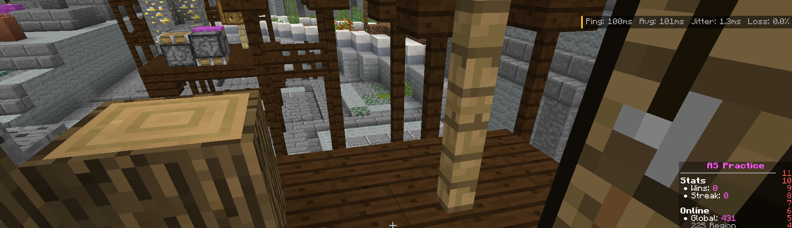

# SeekerNetDiagnostics

A client-side network diagnostics mod for Minecraft 1.8.9 (Forge). It measures ping, packet loss and route
information from inside the game process, so the results reflect the same path as your game connection.

Standalone tools such as `ping` and `tracert` run as separate programs and use ICMP, which connection optimizers
like ExitLag do not route. Their results can therefore differ from what the game actually experiences. This mod
avoids that by sending its probes from Minecraft itself.

## Previews

---

## Use cases

- Determining whether lag comes from your connection or from the server.
- Verifying that ExitLag, a VPN or a similar tool is actually carrying your game traffic, and which relays it uses.
- Locating where latency or packet loss is introduced along the route.
- Comparing latency to different servers or regions without joining them.
- Monitoring ping during play through an on-screen HUD.

## Features

- Live statistics: current, average, median, minimum, maximum, p95, p99, jitter, packet loss and spikes, with a graph.
- Route details: SRV and DNS records, the resolved IP, local and remote socket addresses, network adapter, TCP
  connect time, and detection of local proxies.
- Traceroute using both an in-game TCP check and standard ICMP hops.
- Optional Advanced Tracing (requires administrator rights) that identifies the relays used by a proxy and traces
  the path to each one.
- Configurable HUD: four styles, multiple text colours, quality-based value colouring, scaling, single-line or
  stacked layout, and optional additional statistics.

## Safety

The mod does not read or modify game packets and never joins a server. Each probe is a standard server-list ping,
sent at most once every 0.5 seconds and only to the selected server. Advanced Tracing is disabled by default and
runs in a separate helper process; Minecraft itself is never run with elevated privileges.

For **screensharing** purposes, run `Get-FileHash .\SeekerNetDiagnostics-1.8.9.jar -Algorithm SHA256` and compare the hash with the released version on Github.

## Commands

| Command | Description |
|---|---|
| `/snd` | Monitor the current server |
| `/snd <host> [port]` | Monitor a different server |
| `/snd hud` | Position and configure the HUD |
| `/snd stop` | Stop monitoring |

Keyboard shortcuts in the monitor screen: `Space` pause, `R` reset, `T` trace route, `C` copy summary.
Settings are stored in `config/seekernetdiagnostics.cfg`.

